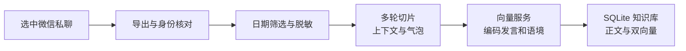
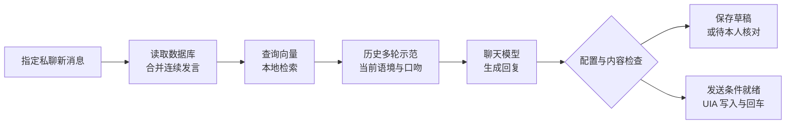

# WeChat RAG Toolkit

**用微信历史对话构建个人语料库，让 AI 参考你真实的表达方式接话。**

Windows · Python 3.11 · 命令行工具 · Apache-2.0

[快速上手](GETTING_STARTED.md) · [自动回复](AUTOREPLY.md) · [开发指南](CONTRIBUTING.md) · [依赖与来源](PROVENANCE.md)

## 项目介绍

WeChat RAG Toolkit 将电脑上的指定微信私聊，整理成带双方角色、上下文和原始气泡边界的 RAG 文档及向量库。结合历史片段和当前对话生成候选回复，再按配置发送到微信。

它关注的是**“我在和这个人聊天时，通常怎样接话”**：历史中的本人发言用于参考口吻，对方发言用于理解情境；解释、调侃、关心或连续说几条，都应结合前后文决定。


## 主要功能

| 能力 | 具体行为 | 当前范围 |
| --- | --- | --- |
| 指定会话导出 | 读取选中私聊，保存正文、消息 ID 及核对发送人的最小来源副本 | 依赖外部 `wechat-cli`，历史须已在电脑上 |
| 清洗与脱敏 | 区分本人/对方、排序去重；自动替换常见敏感格式，支持自定义姓名和地址替换 | 自动规则仍需人工检查 |
| 日期筛选 | 选择起止日期后再构建上下文 | UTC+8，包含起止当天 |
| 多轮切片 | 保留前面在聊什么、对方这轮说了什么，以及本人连发的多条气泡 | 按时间间隔和话题提示等规则划分 |
| 双向量建库 | 分别为对方发言、相关语境生成向量；正文、元数据和向量一起存入 SQLite | 兼容指定协议，可中断续跑，禁止混用模型 |
| 历史口吻回复 | 当前对话检索历史片段，将双方多轮展开为角色示范，再生成回复 | 默认草稿，当前最多参考3个片段 |
| 微信自动发送 | 核验当前会话，UIA 写入、回读文本，再模拟一次回车 | 需手动打开目标私聊，占用前台焦点 |
| 运行控制 | 合并连发、丢弃过期生成结果、人工接管暂停、状态与耗时查询 | 终端服务，无图形控制台 |

## 整体流程

项目分为两条相接的流程。**先建库，再启用回复服务。**

### A. 将历史记录整理成知识库



导出、清洗和切片在本机执行，不需要聊天大模型。向量化将处理后的发言和必要上文发送到你配置的向量服务，知识库文件保存在本机。

完成这条流程后，可以直接使用文档或数据库进行二次开发，不必启动微信回复服务。

### B. 用历史口吻回应新消息



读取新消息依靠数据库；发送依靠微信窗口的 UIA 控件。检索会调用同一向量服务编码当前发言和语境，随后在本地库中查找；聊天模型接收选中的历史片段、口吻要求和最近对话。**建库的历史向量可复用，当前查询仍需要向量模型。**

默认只生成草稿。开启全局开关、联系人发送开关，并使用 `--allow-send` 启动后，才会尝试实际发送。模型或规则要求核对的内容不会自动发出；不确定的发送不会自动重试。

## 片段是什么样的

下面是用于说明切片方式，模型效果展示。

```text
对方：今天事情好多
本人：咋了
本人：又赶一块了？
对方：嗯，忙到现在
本人：先歇会呗
本人：别一直硬撑
```

这个片段会同时保留前面的话题、双方身份和本人连发的气泡。其元数据包含：

```json
{
  "dialogue": [
    {"role": "partner", "bubbles": ["今天事情好多"]},
    {"role": "self", "bubbles": ["咋了", "又赶一块了？"]},
    {"role": "partner", "bubbles": ["嗯，忙到现在"]},
    {"role": "self", "bubbles": ["先歇会呗", "别一直硬撑"]}
  ],
  "target_bubbles": ["先歇会呗", "别一直硬撑"]
}
```

`self` 始终指知识库主人的发言，`partner` 指历史联系人；`target_bubbles` 是这次历史回应中本人的完整气泡序列。回复服务会据此构造 user/assistant 示例，避免把对方口吻当作本人，或把每一轮硬压成一句。

切片边界依然是规则判断，检索相似也不等于口吻准确。建议先检查片段、评估草稿，再判断是否需要调整语料、口吻说明或检索逻辑。

## 如何选择使用方式

| 你的目标 | 需要完成什么 | 入口 |
| --- | --- | --- |
| 先查看、清洗自己的聊天数据 | 导出、清洗 | [入门步骤1—4](GETTING_STARTED.md) |
| 给自己的 RAG 或聊天应用准备资料 | 导出、清洗、切片；需要语义检索时再建库 | [完整建库教程](GETTING_STARTED.md) |
| 尝试让模型模仿本人口吻 | 建库后绑定一个测试联系人，先看草稿 | [自动回复步骤1—3](AUTOREPLY.md) |
| 让指定联系人收到自动回复 | 草稿验证后启用控件与发送开关 | [自动回复步骤4—5](AUTOREPLY.md) |

## 开始前需要准备

| 项目 | 建库 | 自动回复 |
| --- | --- | --- |
| Windows、64位 Python 3.11 | 必需 | 必需 |
| 已登录的电脑微信与可读取历史 | 导出时必需 | 监听时必需 |
| 向量服务的完整 URL、模型名称、key | 生成向量库时必需 | 查询时仍需与建库一致 |
| 聊天模型的完整 URL、模型名称、key | 不需要 | 必需 |
| 打开的目标会话和空输入框 | 不需要 | 实际发送时必需 |
| 常驻服务器或独立向量数据库 | 不需要 | 不需要；电脑服务须保持运行 |

接口使用 OpenAI 兼容协议：向量模型支持 embeddings 批量输入，聊天模型支持 Chat Completions 与 JSON 对象输出，均使用 HTTPS 和 Bearer key。URL、模型和 key 全部由使用者填写，没有内置服务。

## 快速上手

下载仓库并解压后，在项目根目录打开 PowerShell。**第一步先安装依赖**：

```powershell
py -3.11 -m venv .venv
.\.venv\Scripts\python.exe -m pip install -r requirements.txt
.\.venv\Scripts\python.exe -m pip install --no-build-isolation --no-deps "https://github.com/TheRaptors/wechat-cli/archive/6770e1e0c0847e193fb3e3b22e4cd6b93de9aacc.zip"
```

这些命令创建独立环境并安装固定提交的微信读取工具。安装成功后，按下列顺序操作；每一步的用途、完整命令和预期文件见 [从零开始教程](GETTING_STARTED.md)。

| 顺序 | 做什么 | 你会得到什么 |
| --- | --- | --- |
| 1 | 安装、初始化微信读取工具，确认本人账号和对方唯一备注 | 本机读取配置与双方身份 |
| 2 | 导出目标私聊 | `work/snapshot/` 来源副本 |
| 3 | 按需选日期、脱敏和清洗 | `work/clean/clean_messages.jsonl` |
| 4 | 构造多轮对话片段 | `work/episodes/rag_documents.jsonl` |
| 5 | 填写 `credentials.json`，生成双向量索引 | `work/episodes/persona-rag.sqlite` |
| 6 | 填写 `autoreply.json`，先运行服务 | 对新消息的候选回复 |

没有旧向量库也可以从零开始。若记录只在手机上，先用微信自身功能迁移到电脑；电脑当前没有的历史，本工具不能凭空恢复。

### 需要填写哪些文件

所有 `.example` 文件都是模板；复制后填写文件，不修改源码中的 URL 或 key。

| 自己的文件 | 对应模板 | 填写内容 |
| --- | --- | --- |
| `credentials.json` | [credentials.example.json](config/credentials.example.json) | 向量接口 URL、模型和 key |
| `redactions.json`（可选） | [redactions.example.json](config/redactions.example.json) | 姓名、昵称、地址等原文到替代文字的映射 |
| `autoreply.json`（可选） | [autoreply.example.json](config/autoreply.example.json) | 微信读取配置、模型服务、联系人身份、知识库和发送开关 |
| `persona-prompt.txt`（可选） | [persona-prompt.example.txt](config/persona-prompt.example.txt) | 本人的表达习惯和接话要求 |

`wechat-cli init` 另外生成本机数据库读取配置和密钥，一般位于用户目录的 `.wechat-cli/`

## 输出文件与二次开发

| 产物 | 内容 | 可以怎么用 |
| --- | --- | --- |
| `work/snapshot/` | 原始导出与核对来源 | 本机复查导出和发送人归属，含原始隐私 |
| `work/clean/clean_messages.jsonl` | 清洗后的逐条消息 | 人工复查、继续加工 |
| `work/episodes/rag_documents.jsonl` | 多轮正文、角色、气泡和来源元数据 | 接入自己的文档或 RAG 管道 |
| `work/episodes/persona-rag.sqlite` | 片段正文、元数据、发言向量和语境向量 | 本地检索或迁移到自己的检索实现 |
| `work/episodes/style_profile.md` | 从历史统计整理的表达参考 | 与片段一起提供口吻提示 |
| `work/episodes/multiturn-train.jsonl` | 训练分区中的多轮样本 | 进一步清洗评估后，自行接入训练流程 |

SQLite 文件已经包含检索需要的片段正文及元数据；运行回复服务无需重新读取原始导出快照。请保留知识库旁的风格文件；重做清洗或切片时仍需要原始来源。

## 数据与隐私

- **本机处理：** 导出、身份校验、日期筛选、清洗、切片和向量库保存。
- **向量服务接收：** 建库时的处理后发言与上文，查询时的当前发言与最近语境。
- **聊天服务接收：** 最近对话、相关历史片段与口吻要求，用于生成回复。

使用云端服务时，相应内容会离开本机；自动脱敏只覆盖部分规则，近期聊天也不会自动经过历史清洗脚本。配置自己的服务前，请确认数据处理方式和费用。

向量库仍含聊天正文，脱敏后的文档也可能保留身份线索。自己的配置、脱敏映射、聊天库、截图、诊断和日志均应保存在本机。仓库已提供忽略规则，但它不能保护已经被 Git 跟踪的文件。

## 当前限制

| 项目 | 当前情况 |
| --- | --- |
| 界面与部署 | 命令行脚本，无 Web 控制台、桌面安装包或一键部署 |
| 微信兼容性 | Windows 流程已验证，具体版本仍须自行检查；不解析 RMFH 备份容器 |
| 图片、表情包与语音 | 只保存未解析媒体占位，没有看图或语音转写 |
| 联系人 | 只支持私聊；可配置多个对象，但发送前须由使用者打开对应会话，不会自动切换 |
| 后台发送 | UIA 发送需要可见窗口、解锁桌面和前台焦点，不支持锁屏或静默后台 |
| 回复质量 | 受语料、检索、上下文和模型影响，没有“完全复刻本人”的效果保证 |
| 长期运行 | 有队列去重、过期丢弃和结果状态，长期无人值守尚未验收 |

## 项目结构

```text
wechat-rag-toolkit/
├── README.md                 项目介绍与整体流程
├── GETTING_STARTED.md        从零导出、清洗、切片、建库
├── AUTOREPLY.md              草稿、发送、暂停与排错
├── CONTRIBUTING.md           开发入口和测试方式
├── config/                   空白配置和口吻模板
├── tools/                    数据处理与自动回复实现
├── tests/                    虚构数据单元与集成测试
├── vendor/                   外部依赖来源说明
├── requirements.txt          基础依赖
├── requirements-autoreply.txt 可选回复依赖
└── LICENSE / NOTICE / PROVENANCE.md / VALIDATION.json / MANIFEST.json
```

运行时才生成 `.venv/`、`work/` 和自己的配置文件。源码入口与提交约定见 [开发指南](CONTRIBUTING.md)。

## 测试与贡献

安装依赖后执行：

```powershell
.\.venv\Scripts\python.exe -m unittest discover -s tests -p "test_*.py"
.\.venv\Scripts\python.exe .\tests\test_portable_pipeline.py
```

现有52项单元测试，以及独立的虚构数据导出→清洗→切片→建库集成检查。测试不会扫描真实微信、调用真实模型或发送消息；发布验证范围见 [VALIDATION.json](VALIDATION.json)。

欢迎围绕切片质量、召回评估、口吻测试、配置体验和微信版本兼容性贡献代码。媒体解析、自动切换会话、图形界面等能力目前尚未实现，相关 PR 请同时说明行为边界与验证方式。

## 致谢与许可

微信读取与数据库解密由外部 [TheRaptors/wechat-cli](https://github.com/TheRaptors/wechat-cli) 提供；显式无障碍激活使用 [wechatauto-replica](https://github.com/fanyuantaier/wechatauto-replica) 的辅助模块，控件操作使用 [Python-UIAutomation-for-Windows](https://github.com/yinkaisheng/Python-UIAutomation-for-Windows)。这些依赖按固定版本或提交单独安装，不在仓库中重新分发源码。

本项目新增的导出适配、清洗、切片、建库及回复逻辑采用 [Apache-2.0](LICENSE)。第三方保留各自权利与作者归属，详细来源和许可边界见 [NOTICE](NOTICE) 与 [PROVENANCE.md](PROVENANCE.md)。本项目与微信官方无隶属关系，请只处理本人或已获授权的记录。
